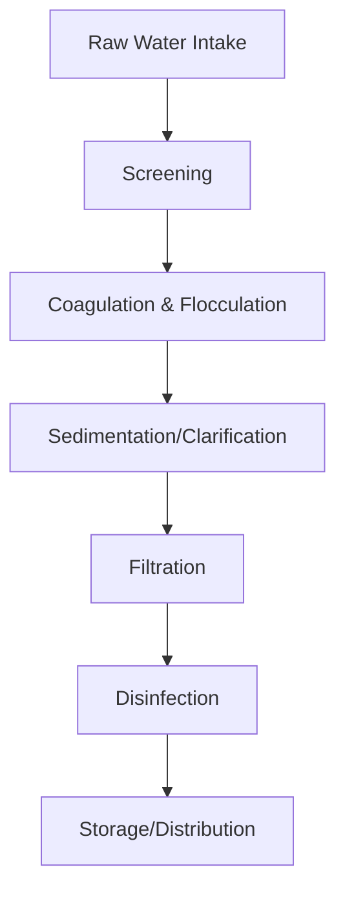
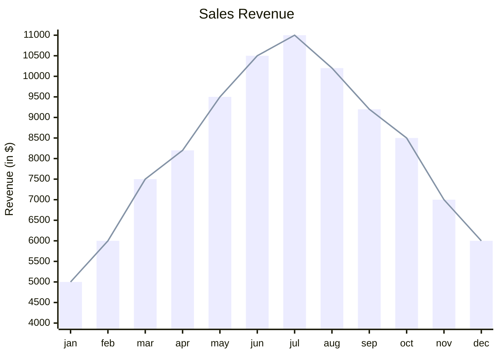
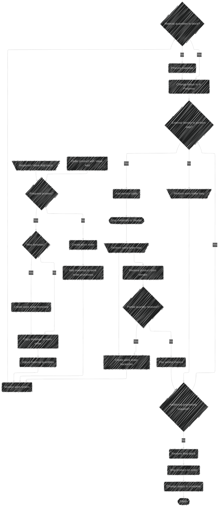
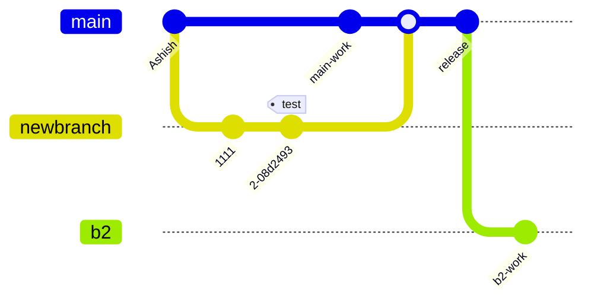
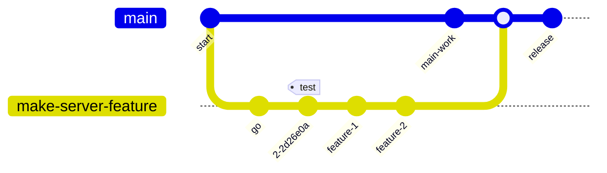
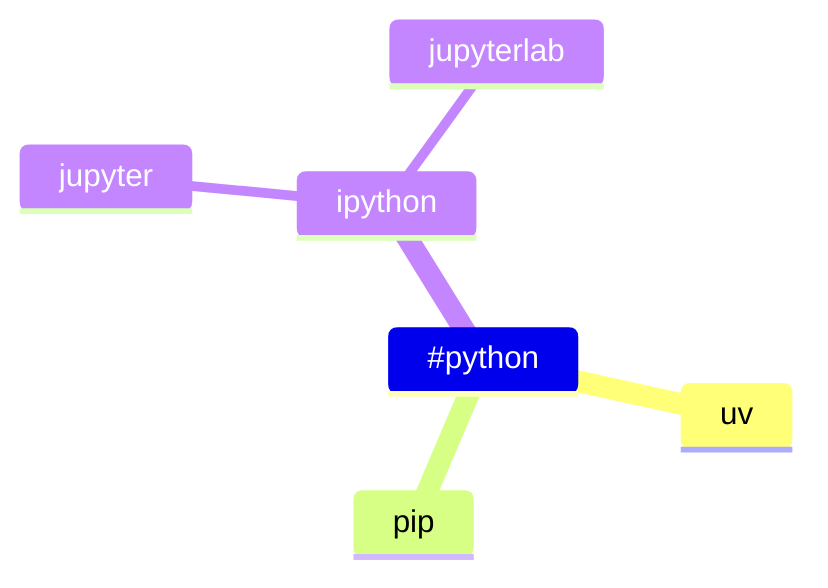
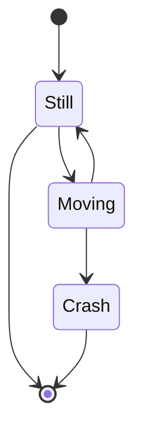
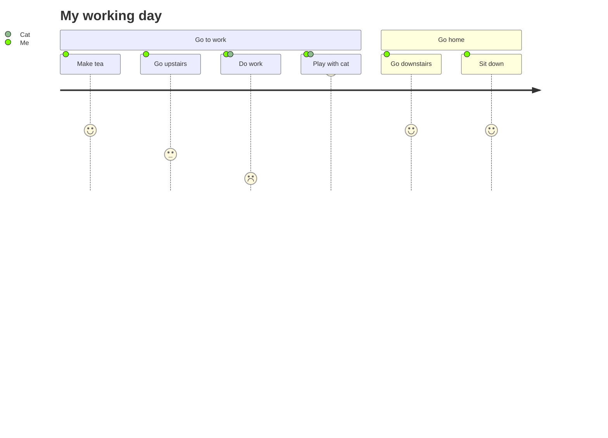
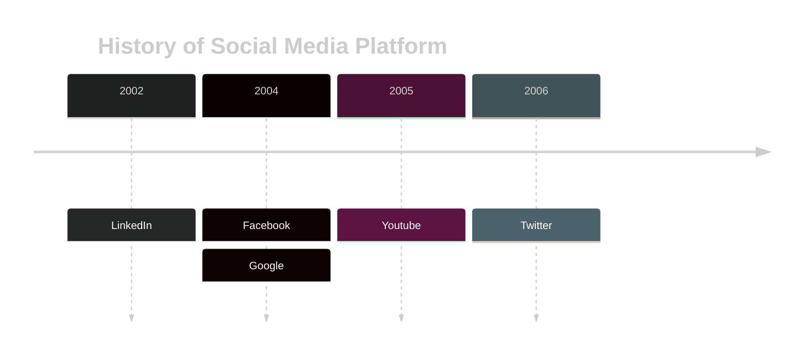
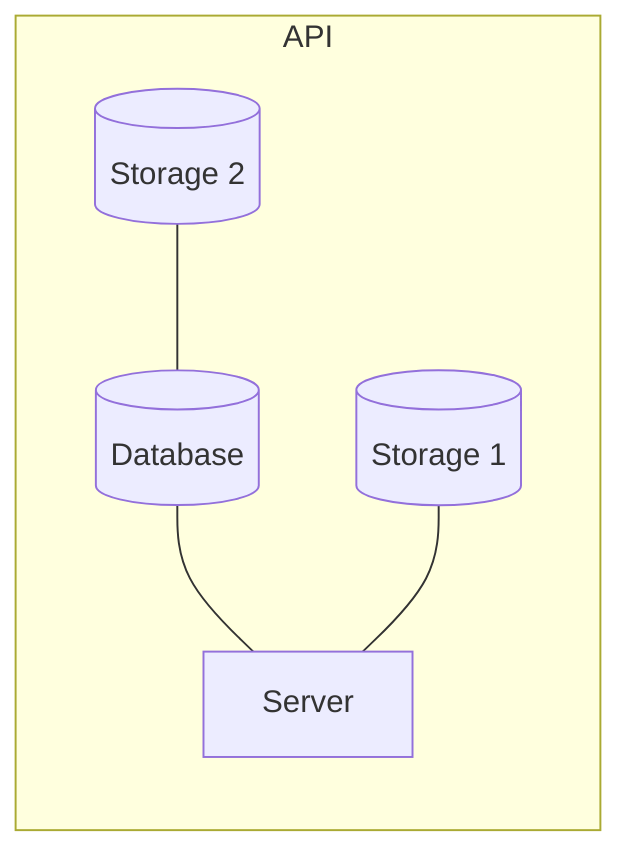

## title

## subtitle

### sub-subtitle

#### sub-sub-subtitle

##### sub-sub-sub-subtitle

###### sub-sub-sub-sub-subtitle

## Glossary

There is a glossary item in vibe coding here and clippy no simpy.

Now you don't have to manually link to how to create a virtual environment
every time you mention virtual environments in any post that needs a virtual
environment.


## Paragraph

Lorem ipsum dolor sit amet, consectetur adipiscing elit, sed do eiusmod tempor
<span class="bg-pink-500" id="inline-tooltip">Hover me</span>
incididunt ut labore et dolore magna aliqua. Ut enim ad minim veniam, quis
nostrud exercitation ullamco laboris nisi ut aliquip ex ea commodo consequat.
Duis aute irure dolor in reprehenderit in voluptate velit esse cillum dolore eu
fugiat nulla pariatur. Excepteur sint occaecat cupidatat non proident, sunt in
culpa qui officia deserunt mollit anim id est laborum.

## CodeBlock

``` python
import this

print("that")
```

## Horizontal rule

---

## Blockquote

> Lorem ipsum dolor sit amet, consectetur adipiscing elit, sed do eiusmod
> tempor incididunt ut labore et dolore magna aliqua. Ut enim ad minim veniam,
> quis nostrud exercitation ullamco laboris nisi ut aliquip ex ea commodo
> consequat. Duis aute irure dolor in reprehenderit in voluptate velit esse
> cillum dolore eu fugiat nulla pariatur. Excepteur sint occaecat cupidatat non
> proident, sunt in culpa qui officia deserunt mollit anim id est laborum.

## Table

| Syntax | Description |
| ----------- | ----------- |
| Header | Title |
| Paragraph | Text |

Tables with a header row are sortable in the default theme.  Select a header to
sort by that column, then select it again to reverse the order.  These examples
cover text, numbers, equal values, and empty cells.

| Feature | Release | Sort order |
| --- | ---: | --- |
| Scroll-drawn roads | 0.14 | Recently added |
| Sortable tables | 0.14 | Recently added |
| Wikilinks | 0.10 | Established |
| Mermaid | 0.12 | Established |

| Item | Count |
| --- | ---: |
| Apples | 10 |
| Pears | 2 |
| Plums | 2 |
| Empty example | |

## Task List

- [x] Write the press release
- [ ] Update the website
- [ ] Contact the media

## Strikethrough

This ~~old example~~ has been replaced with a current one.

## Footnotes

Footnotes can hold a detail without interrupting the paragraph.[^sample-note]

[^sample-note]: This is the footnote text.  It can include **Markdown** too.

## Definition list

Markata
: A static site generator that turns content into a site.

Markdown
: The source format used for this page.

## Heading attributes

This heading has a stable fragment identifier.

### A linkable heading {#sample-heading}

This paragraph has a class attribute. {.sample-note}

## Wikilinks

Wikilinks point to other posts by title or slug: [[about]] and
[[blogging-for-me]].
They can also show hover previews when that feature is enabled by the site.

## Highlight

I need to highlight these ==very important words==.

## Bold

This text has **bold** text

## Italics

This text has _italic_ text

## Subscript

``` markdown
H~2~0
```

H~2~O

## Superscript

``` markdown
X^2^
```

X^2^

## Emoji

Recognized emoji shortcodes render inline; unknown names remain literal.

``` markdown
That is so funny! :joy:

:rocket:

:thumbs_up:

:grinning_face:

:fire:
```

That is so funny! :joy:

:rocket:

:thumbs_up:

:grinning_face:

:fire:

## Abbreviations

*[HTML]: Hyper Text Markup Language
*[W3C]:  World Wide Web Consortium
The HTML specification
is maintained by the W3C.

## Keys

++Ctrl+Alt+Del++

++Win+9++

## Mark

``` markdown
==marked==
```

==marked==

==marked== => <mark>inserted</mark>

## Containers

::: container {.bg-pink-500}
_here be dragons_

here
:::

warning

{.bg-pink-500}
::: warning
_here be dragons_
be careful
:::

more containers

::: name
:::: name
_markdown_
::::

:::

::: sample-nested text-pink-900
:::: sample-nested-inner bg-pink-500
container

## here

there

## there

``` python
import this
```

::::

:::: sample-nested-sibling
second container

I still have pink text, but no pink background
::::

:::

## carousel

::: carousel
:::: carousel-slide
hi
::::
:::: carousel-slide
hi
::::
:::: carousel-slide
hi
::::
:::: carousel-slide
hi
::::
:::: carousel-slide
hi
::::

:::

## Admonitions

!!! note sample note

     this is a sample

???+ note sample note

     this is a sample

     it's collapsible and open

??? note sample note

     this is a sample

     it's collapsible and closed

!!! danger be careful

     this is super dang.

     ## subtitle

!!! reminder

     this is a reminder

!!! caution

     this is a caution

!!! attention

     this is a attention

!!! hint

     this is a hint

!!! error

     this is a error

!!! important

     this is a important

!!! seealso

     this is a seealso

!!! tip

     this is a tip

!!! todo

     this is a todo

!!! warning

     this is a warning

!!! settings

     this is a settings

## vsplit

``` markdown
!!! vsplit I Have two opinions

    !!! vsplit Left Opinion

        supporting arguments

        * lorem ipsum
        * ipsum dolor

        - [x] lorem ipsum
        - [ ] ipsum dolor

    !!! vsplit Right Opinion

        supporting arguments

        * lorem ipsum
        * ipsum dolor

        - [ ] lorem ipsum
        - [x] ipsum dolor
```

Here is the result of that markdown.

!!! vsplit I Have two opinions

    !!! vsplit Left Opinion

        supporting arguments

        * lorem ipsum
        * ipsum dolor

        - [x] lorem ipsum
        - [ ] ipsum dolor

    !!! vsplit Right Opinion

        supporting arguments

        * lorem ipsum
        * ipsum dolor

        - [ ] lorem ipsum
        - [x] ipsum dolor

A clean vsplit

{.clean}
!!! vsplit ""

    !!! vsplit Hello World

        Here is a hello world application written in the typer cli framework
        for cli.

    !!! vsplit ""

        ``` python
        #!/usr/bin/env -S uv run --quiet --script
        # ///
        # requires-python = ">=3.12"
        # dependencies = [
        #     "typer",
        # ]
        # ///

        import typer

        app = typer.Typer()

        @app.command()
        def hello(name: str = "World"):
            """Prints a greeting message."""
            typer.echo(f"Hello, {name}!")

        if __name__ == "__main__":
            app()
        ```

## html in md

html without the markdown atrribute will not be parsed as markdown

!!! vsplit ""

    !!! vsplit ""

        ``` markdown
        <div>
        # markdown in html

        This is not markdown
        </div>
        ```

    !!! vsplit ""
        <div>
        # markdown in html

        This is not markdown
        </div>

If you give an html tag the `markdown="1"` attribute, the markdown will be
parsed and rendered as html inside of that tag.

!!! vsplit ""
    !!! vsplit ""

        ``` markdown
        <div markdown="1">

        # markdown in html

        This is a *Markdown* Paragraph.

        </div>
        ```

    !!! vsplit ""
        <div markdown="1">

        # markdown in html

        This is a *Markdown* Paragraph.

        </div>

## mermaid diagrams







## Scroll-drawn roads

Road containers turn lists of links into paths that draw as the reader scrolls.
The default theme includes styles for timelines, steps, snake paths, cycles,
constellations, Git histories, and editorial timelines.  The links below use
pages on this site.

::: road timeline

- [About](/about/) Start here
- [Blogging for me](/blogging-for-me/) Find the why
- [Hot tips](/hot_tips/) Keep learning
:::

Steps place the milestones from left to right on wide screens and in a timeline
on narrow screens.

::: road steps

- [Read](/about/) Browse
- [Build](/hot_tips/) Make something
- [Write](/blogging-for-me/) Share it
:::

The other built-in layouts work with the same linked list.  These compact
examples keep every road style available for checking in the default theme.

::: road winding

- [About](/about/) One
- [Hot tips](/hot_tips/) Two
- [Blogging for me](/blogging-for-me/) Three
:::

::: road snake

- [About](/about/) One
- [Hot tips](/hot_tips/) Two
- [Blogging for me](/blogging-for-me/) Three
:::

::: road cycle

- [Read](/about/) Draft
- [Write](/blogging-for-me/) Publish
- [Learn](/hot_tips/) Repeat
:::

::: road constellation

- [About](/about/) Me
- [Hot tips](/hot_tips/) Notes
- [Blogging for me](/blogging-for-me/) Process
:::

::: road git

- [About](/about/) main
- [Hot tips](/hot_tips/) feature
- [Blogging for me](/blogging-for-me/) merge
:::

::: road editorial

### Write

Start with a draft.

- Gather notes
- Pick a point

### Revise

Make the useful bits easier to find.

### Publish

Ship the post and link to it.
:::

gitgraph

These GitGraph examples use syntax supported by the deployed Mermaid 10.9.5 renderer.









The journey





Architecture diagrams below use Mermaid 10-compatible flowcharts.  The
`architecture-beta` diagram family requires a newer Mermaid runtime.



```` markdown

````


## can it vsplit

!!! vsplit ""
    !!! vsplit ""

        ```` markdown
        ``` mermaid
        flowchart LR
            subgraph API["API"]
                db[("Database")]
                disk1[("Storage 1")]
                disk2[("Storage 2")]
                server["Server"]
            end
            db --- server
            disk1 --- server
            disk2 --- db
        ```
        ````

    !!! vsplit ""

        ``` mermaid
        flowchart LR
            subgraph API["API"]
                db[("Database")]
                disk1[("Storage 1")]
                disk2[("Storage 2")]
                server["Server"]
            end
            db --- server
            disk1 --- server
            disk2 --- db
        ```

version {{ version }}

<wa-tooltip  for="inline-tooltip" trigger='manual' id='inline-tooltip-tooltip'>
    <div class='bg-black rounded-xl border-2 border-pink-500 max-h-96 overflow-y-scroll'>
        <a href='/glossary/vibe-coding' class="bg-pink-500 text-white uppercase mx-4" style='color:white'>Vibe Coding</a>
        <div  hx-get='/glossary/vibe-coding/partial' hx-trigger='load' hx-swap='outerHTML'></div>
    </div>
</wa-tooltip>

<script>
  const tooltip = document.getElementById('inline-tooltip-tooltip');
  const anchor  = document.getElementById('inline-tooltip');

  let overAnchor = false;
  let overTip    = false;
  let closeTimer = null;

  function openTip() {
    clearTimeout(closeTimer);
    tooltip.open = true;
  }
  function scheduleClose(delay = 200) {
    clearTimeout(closeTimer);
    closeTimer = setTimeout(() => {
      if (!overAnchor && !overTip) tooltip.open = false;
    }, delay);
  }

  // Anchor hover intent
  anchor.addEventListener('pointerenter', () => {
    overAnchor = true;
    openTip();
  });
  anchor.addEventListener('pointerleave', () => {
    overAnchor = false;
    // give the user time to move into the tooltip
    scheduleClose(200);
  });

  // Tooltip hover intent
  tooltip.addEventListener('pointerenter', () => {
    overTip = true;
    openTip();
  });
  tooltip.addEventListener('pointerleave', () => {
    overTip = false;
    scheduleClose(100);
  });

  // Optional: open on focus, close on blur/Escape for a11y
  anchor.addEventListener('focusin', openTip);
  anchor.addEventListener('focusout', () => scheduleClose(100));
  document.addEventListener('keydown', (e) => {
    if (e.key === 'Escape') tooltip.open = false;
  });
</script>


## You==Tube== **one** line links

https://youtu.be/dQw4w9WgXcQ

https://www.youtube.com/watch?v=dQw4w9WgXcQ

https://www.youtube.com/embed/dQw4w9WgXcQ
